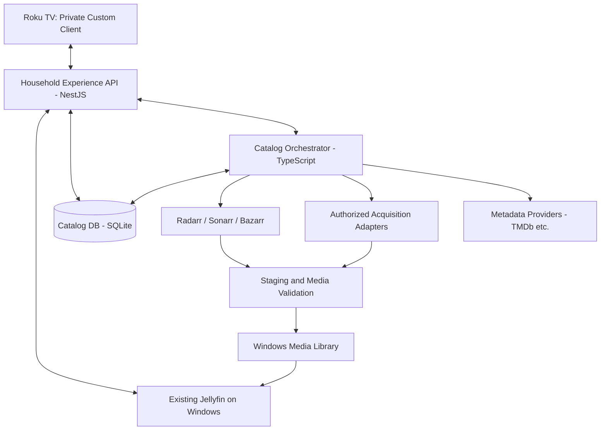
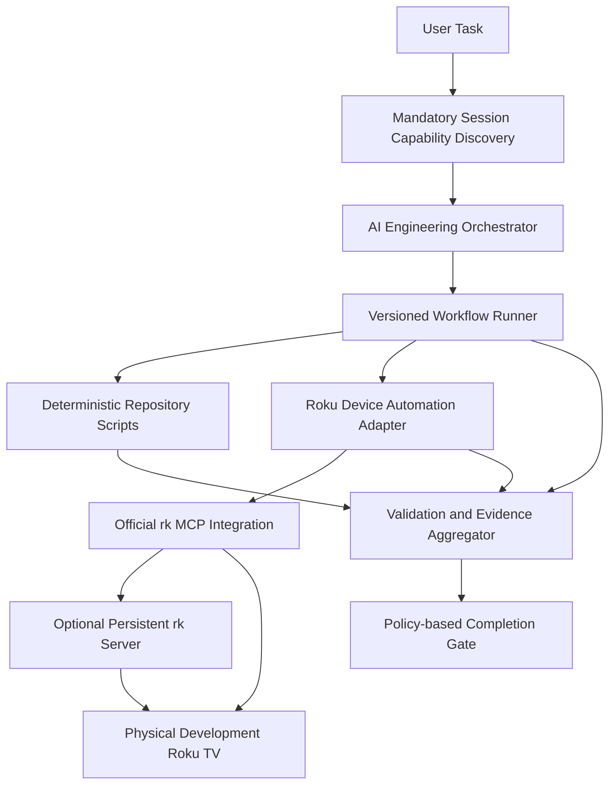

# Household Streaming Platform — Comprehensive Engineering Specification

**Version:** 1.1  
**Date:** 2026-11-10  
**Status:** Consolidated design specification; existing M0 implementation must be reused; SDK, hardware, MCP, and source integrations require verification  
**Deployment:** Private household, Windows host, sideloaded Roku TV client

**Revision provenance:** Incorporates *Roku MCP Integration — Specification Addendum and M0 Implementation Handoff*, HSP-ADDENDUM-RK-MCP-001 v1.0, into this specification. Sections 1–14 retain their numbering; §15 contains the detailed normative Roku MCP requirements and incremental handoff. The separate addendum is superseded by this document.

**Implementation directive:** Extend the existing M0 agents, behaviors, registry, runner, scripts, schemas, tests, and evidence model; do not recreate M0 or assume an uninitialized repository. Examples are proposed interfaces, not proof of available commands or SDK support. Verified installed SDK behavior and the implemented runner schema govern syntax; security and explicit human authorization take precedence over automated device operations.

## 1. Executive Summary

Build a private, Roku-first household streaming system with a Netflix-like browsing and playback experience, using an existing Jellyfin server on Windows. A custom Roku client will provide polished navigation and playback. A Household Experience API will assemble presentation-ready catalog data and mediate secure access to Jellyfin. A separate autonomous Catalog Orchestrator will continuously discover, rank, import, validate, and rotate media **only from authorized sources**. A repository-native AI engineering framework will make building and maintaining the system repeatable, testable, and auditable.

### Goals

- One household user profile and shared watch state, favorites, and recommendations.
- Custom Roku TV app distributed solely through developer-mode sideloading.
- Browse playable titles with hero features, Continue Watching, Recently Added, Movies, Series, Search, Details, and Next Episode.
- Roku remote-first focus management, accessible text, fast loading, and predictable Back behavior.
- Direct Play preferred, with Jellyfin transcoding fallback.
- Continuous catalog discovery and policy-driven acquisition of legally obtainable files, without routine approval.
- Storage-aware retention and safe, auditable catalog rotation.
- Native Windows development and operation; mock-only frontend development without live services.
- Mandatory AI capability discovery at the beginning of **every** agent session or chat, before task planning or execution.
- Official Roku SDK MCP integration as a local engineering capability for authorized, evidence-backed build/deploy/navigation/inspection loops, with explicit device compatibility gates.

### Non-goals

- Public Roku Channel Store distribution, multi-user profiles, payments, advertising, or monetization.
- DRM circumvention, scraping or downloading subscription-service protected streams, or guaranteeing availability of Netflix's catalog.
- Reimplementing Jellyfin's media server, transcoder, or core library functionality.
- Automatically deleting pre-existing/unmanaged household media.

## 2. Architecture and Boundaries



**Source-of-truth rules:** Jellyfin owns playable items, streaming, playback sessions, watch state, and favorites where supported. The catalog database owns discovery candidates, scores, source eligibility, automation decisions, jobs, and policy versions. The Roku app owns only transient UI state and a revocable device credential. The Experience API composes display-ready data; it must not directly manage media files. The Catalog Orchestrator owns acquisition and retention decisions; it must not contain Roku UI logic.

**Failure isolation:** Existing media remains browsable and playable if discovery, TMDb, Radarr, Sonarr, or the orchestrator is unavailable. Cache last-known home rows and avoid hard dependencies on acquisition services for playback.

**Engineering automation boundary:** A **Roku Device Automation Adapter** connects the engineering workflow runner to the official SDK MCP integration and the physical development TV (see §15.1). MCP is development/QA infrastructure, never a dependency of the shipped Roku app, Experience API, or production Catalog Orchestrator. Playback must remain available when MCP is disconnected. Serialize physical control per TV with an exclusive lease. The automation host may initially share the Windows media-server machine, but retain configuration for separating them later.

## 3. Technology Stack and Compatibility Gates

| Concern | Target | Notes |
|---|---|---|
| TV client | Roku RSG 2.0 / TypeScript, if supported | Verify actual Roku TV model, OS version, SDK availability, and successful sideload before commitment |
| Fallback TV client | BrightScript + SceneGraph | Use if RSG 2.0 cannot run on hardware; keep same API contract |
| API | NestJS + TypeScript | Local LAN service |
| Catalog worker | Node.js + TypeScript | Independent Windows service |
| Persistence | SQLite + Prisma | Single-host deployment; use migrations and backups |
| Media server | Existing Jellyfin | Preserve existing installation and library |
| Media managers | Radarr, Sonarr; Bazarr optional | Import and episode management; not sources of licensed media |
| Inspection | FFprobe / FFmpeg | Probe media, remux/transcode when required |
| Testing | Jest, Supertest, Roku SDK/device tooling | Real-device testing mandatory for playback and remote navigation |
| Toolchain | pnpm workspace, Node LTS compatible with Roku SDK | Confirm SDK's actual Node/pnpm requirements |
| Host | Windows | Native services, no required Docker/WSL |
| AI workflows | Versioned manifests + allowlisted scripts | Tool/vendor-agnostic |
| Roku engineering tooling | Pinned `@roku-sdk/tooling`, official `rk mcp`, VS Code MCP client | Stdio first; verify installed tool reference, Windows/Node compatibility, and target TV support |
| Persistent device automation | Optional `rk server` on trusted Windows host | Add only for multi-client access, long-running loops or continuous logs; observe actual endpoint and serialize TV control |

**Hardware gate:** Determine Roku OS, model, resolution, codec support, available memory, and developer-mode sideload success. Do not assume every Roku TV supports RSG 2.0 or all HEVC/HDR/audio combinations. Preserve the Jellyfin Roku app as a fallback until the custom player is validated.

**MCP compatibility gate:** Confirm the selected RSG 2.0 SDK/tooling, signing behavior, native Windows support, and actual TV compatibility before declaring integration verified. Preserve the existing M0 toolchain until a compatibility spike proves migration safe. If RSG 2.0 is unsupported, retain the automation abstractions and document a supported legacy SceneGraph alternative; do not report MCP-driven RSG validation as passed.

## 4. Functional Requirements

### 4.1 Roku UX

- Screens: Home, Movies, TV Shows, Search, Media Details, Seasons/Episodes, Player, Settings, Connection/Pairing, Error/Offline.
- Home rows: Featured, Continue Watching, New Episodes, Recently Added, Recommended Tonight, Genre/Collection highlights. Primary home shows **playable** Jellyfin items only.
- Details: artwork, synopsis, release year, rating where available, runtime, cast, play/resume, favorite, seasons, related titles.
- Search: debounced, remote-friendly keyboard, explicit loading/empty states; no assumption of browser APIs.
- Remote focus: deterministic directional graph, visible focus indicator, preserved row/card/scroll position after returning, predictable Back, no autoplay on focus.
- Performance: lazy artwork loading, virtualization/windowing for large rows, cache with bounded memory, avoid unnecessary animations.
- Playback: start/resume, seek, pause, subtitles, audio selection, Next Episode, completion, progress updates, errors and recovery.
- Shared household state: one Jellyfin account; no profile chooser after pairing.

### 4.2 Playback and Compatibility

- Prefer Direct Play where the TV supports container, video, audio, and subtitle formats; allow Direct Stream/remux or Jellyfin HLS transcoding fallback.
- Conservative initial ingest target: 1080p H.264, AAC stereo, MP4, external SRT. This is a fallback profile, **not** a mandatory conversion of all media.
- Inspect imported media using FFprobe; record codec, resolution, HDR, audio/subtitle streams, and predicted Roku compatibility.
- Do not convert originals solely based on guesses. Validate device-specific support and transcode only when required.
- Create playback sessions through the Experience API; never embed administrative Jellyfin API keys in Roku packages.
- Track play, progress, pause/stop, completion and resume. Define reconciliation behavior for interrupted sessions and retries.
- Support LAN reachability; Roku must connect to the Windows host's LAN address, not `localhost`.

### 4.3 Catalog Discovery and Acquisition

- Refresh trending/popular metadata every 6 hours; new releases daily; monitored episodes every 6 hours; reconciliation every 15 minutes.
- Normalize metadata IDs; deduplicate movies, series, seasons, and episodes; maintain provider provenance.
- Discovery catalog is distinct from playable catalog. Metadata does not imply a downloadable video.
- Rank candidates with deterministic scoring: household taste 30%, trends 20%, ratings 15%, recency 15%, series continuity 10%, diversity 10%. Make weights configurable, versioned and testable.
- Hard eligibility gates: authorized source, accessible playable file, media type, policy filters, duplicate checks, storage capacity, and quality limits.
- Automatic acquisition for eligible content; no manual approval required under normal policy. Missing authorized source leaves candidate discovery-only.
- Initial rate limits: 2 concurrent jobs, 3 new movies/day, 2 new series/week; tune after observing actual sources and storage.
- State machine: DISCOVERED → EVALUATED → QUEUED → ACQUIRING → VALIDATING → AVAILABLE; alternate INELIGIBLE, FAILED, RETENTION_REVIEW, RETIRED.
- All transitions are durable, idempotent, retriable with bounded backoff, and audited.
- Acquisition adapters must document source authorization and licensing constraints; do not integrate DRM circumvention or unauthorized redistribution.

### 4.4 Storage and Retention

- Proposed high watermark: 85% utilization; cleanup target: 75%; reserve at least 100 GB, subject to actual disk capacity.
- Minimum retention: 30 days; unwatched review after 90 days.
- Protect favorites, pinned titles, in-progress content, active series and required unwatched episodes, in-flight imports, unmanaged files, and all media when mounts/health checks are abnormal.
- Start with deletion **disabled**, dry-run enabled, and at least seven days of reviewed removal proposals.
- Restrict destructive actions to explicitly managed paths and canonical file identities; never follow unsafe symlinks/reparse points outside managed roots.
- Reconcile the filesystem and Jellyfin before any deletion. Prefer quarantine/soft-delete with a recovery window before permanent removal.
- Log policy version, title, paths, sizes, reasons, and pre/postconditions for every retirement.

## 5. Proposed Repository

```text
household-streaming/
├── AGENTS.md
├── apps/
│   ├── roku/
│   │   ├── src/{app,screens,components,navigation,facades,providers,playback,theme}/
│   │   ├── assets/
│   │   └── tests/
│   ├── api/src/{modules,integrations}/
│   └── orchestrator/src/{discovery,ranking,acquisition,media-validation,retention,reconciliation,scheduling,adapters}/
├── packages/
│   ├── contracts/
│   ├── domain/
│   ├── database/
│   ├── configuration/
│   ├── test-fixtures/
│   └── observability/
├── .agents/
│   ├── agents/{orchestrator,roku,api,catalog,quality,infrastructure}.md
│   ├── workflows/{implement-feature,fix-bug,refactor,add-roku-screen,add-catalog-source,change-api-contract,deploy-roku,release,maintenance}.md
│   ├── workflows/{roku-mcp-setup,roku-device-smoke,roku-development-loop,roku-focus-audit,roku-playback-audit,roku-device-diagnostics}.md
│   ├── behaviors/{code-ownership,deterministic-execution,error-recovery,security,validation,documentation}.md
│   ├── behaviors/{roku-device-safety,device-evidence-integrity}.md
│   ├── integrations/roku-mcp.md
│   ├── manifests/
│   ├── schemas/{task,workflow,evidence,capability}.schema.json
│   ├── schemas/roku-device-evidence.schema.json
│   └── templates/{task-brief,implementation-plan,change-report,validation-report}.md
├── scripts/
│   ├── ai/
│   ├── roku/                       # Preflight, device verification, build/deploy, smoke and evidence
│   ├── scaffold/
│   ├── validate/
│   ├── test/
│   ├── deploy/
│   └── maintenance/
├── infrastructure/{windows,scripts,monitoring}/
├── docs/{architecture,adr,api,development,operations,testing}/
├── .vscode/mcp.json                # Official stdio configuration; no secrets
├── .github/workflows/
├── pnpm-workspace.yaml
├── package.json
└── .env.example
```

**Code conventions:** Smart/dumb separation; Roku presentation components depend on facades; facades depend on provider interfaces; mock and HTTP providers implement the same interfaces. Shared contracts must remain JSON-serializable and free of Node/NestJS/Prisma/browser-only dependencies. Use versioned OpenAPI contracts and explicit schema validation at API boundaries. Architecture decisions are recorded as ADRs.

**Incremental integration:** The tree is a target, not a requirement to duplicate existing equivalents. Reuse the current M0 directories and naming, including existing operations runbooks. Add a separate device-automation package only if architecture justifies it; otherwise follow current M0 conventions. Register SDK-generated `mcp-setup` and `mcp-ai-dev-loop` skills in their SDK-prescribed locations instead of copying divergent versions. Generated device artifacts belong under the existing task artifact root.

## 6. API Surface and Contract

| Route | Purpose |
|---|---|
| `GET /v1/home` | Display-ready curated rows |
| `GET /v1/catalog/movies` | Movie browse/filter/sort |
| `GET /v1/catalog/series` | Series browse/filter/sort |
| `GET /v1/catalog/search?q=` | Search playable items |
| `GET /v1/catalog/:id` | Details and related titles |
| `GET /v1/series/:id/episodes` | Seasons and episodes |
| `POST /v1/devices/pair` | One-time household device pairing |
| `POST /v1/playback/sessions` | Negotiate playable stream and resume |
| `POST /v1/playback/:id/progress` | Idempotent watch progress |
| `POST /v1/playback/:id/stop` | Stop and finalize session |
| `POST /v1/household/favorites` | Favorite changes |
| `GET /v1/health` | Liveness/readiness diagnostics |

Illustrative TypeScript contracts:

```typescript
interface HomeResponse {
  featured: MediaSummary | null;
  rows: CatalogRow[];
  generatedAt: string;
}
interface CatalogRow {
  id: string;
  title: string;
  layout: 'poster' | 'landscape';
  items: MediaSummary[];
}
interface MediaSummary {
  id: string;
  jellyfinItemId: string | null;
  type: 'movie' | 'series' | 'episode';
  title: string;
  year?: number;
  overview?: string;
  posterUrl?: string;
  backdropUrl?: string;
  progressPercent?: number;
  isFavorite: boolean;
  isPlayable: boolean;
}
interface PlaybackSession {
  sessionId: string;
  mediaUrl: string;
  streamFormat: 'direct' | 'hls';
  resumePositionMs: number;
  subtitles: SubtitleTrack[];
  audioTracks: AudioTrack[];
}
```

Complete missing types and security semantics during implementation. All playback URLs/tokens must be short-lived or appropriately scoped, never logged, and validated for Roku compatibility.

## 7. Windows Environment and Deployment

- Develop locally with native Node/pnpm processes; do not require containers.
- Preserve existing Jellyfin configuration and libraries; record version, library paths, service mode and port.
- Use dedicated Windows service identities and scoped filesystem permissions for API, orchestrator and media managers.
- Install independent services with restart-on-failure, health checks and logs; document service manager choice.
- Use stable LAN addresses or DHCP reservations; permit only required private-network firewall ports.
- Do not expose administrative interfaces or unauthenticated APIs to the public internet.
- Keep secrets in environment/secret storage outside Git; maintain `.env.example` with placeholders only.
- Resolve `rk` from a pinned local workspace dependency, not an unpinned registry fetch. Configure the editor for stdio initially; see §15.3 for Windows setup, generated skills and process lifecycle.
- Configure an explicit named development TV on a reachable trusted LAN. Record developer mode and firewall/VLAN constraints without changing network policy implicitly. Keep developer credentials outside Git and chat/evidence logs.
- Keep any MCP listening endpoint on localhost or approved private interfaces. Persistent-server lifecycle is independent of production media services; an offline TV must not block unrelated backend/static checks.

Suggested configurable paths:

```text
C:\HouseholdStreaming\config\
C:\HouseholdStreaming\data\catalog.sqlite
C:\HouseholdStreaming\logs\
C:\HouseholdStreaming\backups\
D:\Media\Movies\
D:\Media\TV\
D:\Media\Staging\{Incoming,Processing,Quarantine}\
D:\Media\Trash\
```

Do not assume a `D:` drive exists. Favor same-filesystem staging/imports where feasible. Back up application data and configuration separately from large media files. Restore testing is required.

## 8. AI-Native Engineering System

### 8.1 Mandatory Session Initialization — Discover Before Acting

**Invariant:** At the beginning of **every** new agent session or chat, before task planning or any task-specific action, the agent MUST discover and evaluate repository-defined capabilities. The only permissible pre-discovery actions are locating the repository and reading the minimal bootstrap instructions needed to run discovery.

Required sequence:

1. Locate and read root `AGENTS.md`.
2. Execute `pnpm ai:discover --task "<user request>"` or equivalent bootstrap command if dependencies are not yet installed.
3. Scan and validate inventory of agents, behaviors, workflows, scripts, skills, templates, schemas, ADRs and runbooks.
4. Load full instructions for globally mandatory behaviors and task-matched capabilities, including dependencies.
5. Match available capabilities to the request; resolve instruction precedence and record missing capabilities.
6. Produce a **session discovery receipt** with session ID, task fingerprint, registry revision/hash, selected capabilities, mandatory gates and timestamp.
7. Only after successful discovery may the agent plan and execute task-specific work.

**Roku MCP discovery:** Include repository MCP configuration, installed SDK/version, official AI skills, verified tool reference, advertised/callable tools where client discovery is available, server health, configured device identity, applicable safety policy, and non-mutating reachability checks. Report `ready`, `degraded`, `blocked`, or `not_applicable` separately for Roku MCP. Registered does not mean installed, advertised does not mean callable, and callable does not mean device-reachable. The scan is mandatory; a disconnected TV blocks only device-dependent execution/acceptance, not unrelated API/catalog or offline mock work. Device preflight does not authorize deployment or reboot. See §15.4.

**Refresh conditions:** New chat always triggers discovery. Material task changes or capability registry changes invalidate prior matching and require a new scan. A subagent must receive and validate an applicable discovery receipt or perform its own discovery before acting.

**Failure mode:** If required discovery cannot complete, stop task-specific execution and report the blocker. Do not pretend a registry scan succeeded.

**Reuse policy:** Prefer existing workflows, scripts, components, schemas and templates. Extend reusable assets when appropriate; only create new capabilities when no suitable one exists. Register and test new capabilities before use.

### 8.2 Discovery Implementation

Use a two-stage approach: (A) inspect all capability manifests and validate registry completeness against filesystem entries; (B) load relevant instructions and mandatory global behaviors. Do not require loading every Markdown file into the model context. Capability manifests should declare ID, type, description, tags, entrypoint, dependencies, applicability, owner, permissions, validations and version. A generated index may accelerate lookup but cannot override actual manifests.

Required commands (to be implemented, not assumed to exist):

```bash
pnpm ai:discover --task "Implement Roku search"
pnpm ai:inventory
pnpm ai:validate-registry
pnpm ai:explain --capability add-roku-screen
pnpm ai:verify-session
```

Workflow runner and CI must reject task completion evidence lacking valid discovery, and the runner must reject execution without a valid current discovery receipt. Receipt validity is tied to the task scope and registry version; no agent can manually mark discovery as passed.

Extend the existing registry with Roku MCP availability observations and a versioned catalog of verified installed tool signatures/schemas. Compare dynamic tool advertisement to that reference and detect SDK/catalog/official-skill drift. Discover client access honestly: if tools cannot be enumerated or called from the current host, record that limitation rather than infer connectivity. Dynamic availability must not make unrelated capability discovery fail solely because a TV is offline.

### 8.3 Agent Roles

| Agent | Ownership | Boundaries |
|---|---|---|
| Engineering Orchestrator | Plan, delegate, integrate, verify | Cannot bypass gates |
| Roku Specialist | TV screens, navigation, focus, playback client | No backend business rules |
| API Specialist | NestJS, contracts, auth, Jellyfin adapter | No direct media deletion |
| Catalog Specialist | Discovery, ranking, acquisition, retention | No Roku UI changes |
| Infrastructure Specialist | Windows services, network, backups, deployment | No unreviewed product changes |
| Quality Specialist | Test design, execution and evidence | Cannot silently weaken tests |

**Device scopes:** The orchestrator authorizes/co-ordinates device sessions and arbitrates exclusive leases. Roku specialists may build, deploy and navigate only an explicitly configured development TV under workflow authorization. Quality specialists execute approved test journeys and capture/assert evidence, not change application code merely to force a pass. Infrastructure specialists own SDK/MCP configuration and credential injection; firewall, reboot, signing and secret changes require applicable approval. API/catalog roles may consume device results but gain no device-control permission by default. See §15.5.

### 8.4 Mandatory Agent Behaviors

- Inspect existing code and architecture before edits; never invent API or SDK details.
- Prefer deterministic scripts over improvised commands.
- Use seeded mocks, fixed clocks, explicit inputs and pinned dependencies where feasible.
- Keep Roku presentation and data providers separate.
- Mock-only UI development must require no Jellyfin, DB or external API.
- Use small, scoped changes and document cross-domain contract updates.
- Treat unexecuted tests as **blocked/skipped**, never passed.
- Tie evidence to exact commit SHA and rerun affected validations after changes.
- Keep credentials out of logs and Roku packages.
- Enforce approval for destructive production changes, credential rotation, network policy changes and risky deployment.
- Update runbooks/ADRs/contracts when behavior changes.
- Target an explicitly identified device, acquire the required exclusive lease, and use non-destructive defaults. Treat sideloading as replacement of the current development-app slot, not coexistence with another sideloaded app.
- Redact credentials, household network details, stable raw device IDs and playback tokens before persisting tool output. Preserve task/commit/tool/device provenance and artifact checksums.
- Never invent MCP tool names or parameters. Use the installed SDK's generated reference and official skills, subject to repository safety policy.
- Do not blindly replay a timed-out/lost mutating MCP request: a forwarded server operation may still be running. Reconcile operation state first; bound retries, iteration counts and total device-session duration.
- Treat mock, build, deployment, screenshot, focus and playback results as distinct checks. A successful earlier stage does not prove a later stage.

### 8.5 Workflow Catalog

| Workflow | Outputs |
|---|---|
| Implement feature | Code, tests, evidence |
| Fix bug | Reproduction, fix, regression test |
| Add Roku screen | Component/screen, facade, fixtures, focus tests |
| Add UI component | Reusable component, states, tests |
| Change API contract | Schema, implementation, compatibility tests |
| Add catalog provider | Adapter, authorization policy, fixtures, tests |
| Modify ranking policy | Versioned policy, deterministic score tests |
| Modify retention policy | Simulation, safety review, dry-run report |
| Refactor | Behavior-preserving verification |
| Upgrade dependency | Compatibility and regression evidence |
| Deploy Roku | Package, deployment result, device checks |
| Release backend | Service deployment, health, rollback evidence |
| Diagnose incident | Root cause and verified remediation |
| Maintenance | Dependency, health and security report |
| Roku MCP setup | Pinned/configured tooling, official skills, tool catalog, availability and compatibility report |
| Roku device smoke | Authorized build/sideload/startup/navigation assertions, screenshots, hierarchy and diagnostics |
| Roku development loop | Bounded build/deploy/exercise/inspect/repair cycles and commit-bound evidence |
| Roku focus audit | Remote key journeys, expected/actual focus and restoration assertions |
| Roku playback audit | Authorized media playback/resume/subtitle/audio/progress/recovery evidence |
| Roku device diagnostics | Redacted state/logs, decoded stack traces, reproduction and remediation plan |

**Standard lifecycle:** Discover → Define task → Plan → Implement → Validate → Verify behavior → Record evidence. Do not treat a passing build as proof of working playback or navigation.

Add setup and smoke workflows first; development-loop, focus and playback audits follow incrementally as M1/M2 require them. Detailed contracts, authorization, lease cleanup and limits are in §15.6.

### 8.6 Script Interface

Proposed commands, each backed by an actual script before being advertised as available:

```bash
pnpm dev:mock
pnpm dev:api
pnpm scaffold:screen --name Search
pnpm scaffold:adapter --name ExampleSource
pnpm validate
pnpm test:contracts
pnpm test:catalog
pnpm roku:build
pnpm roku:deploy --device <LAN_IP>
pnpm health:check
pnpm ai:verify
```

Script contract: `--help`, noninteractive operation, explicit arguments, consistent nonzero failure codes, machine-readable JSON evidence, bounded retries, no secret leakage, safe path handling, and `--dry-run` for destructive or external mutations. Scripts are resolved through an allowlisted command registry; workflow YAML must not allow arbitrary shell execution or path traversal.

Roku aliases (or existing equivalents) additionally include `roku:mcp:check`, `roku:device:verify`, `roku:deploy:dev`, `roku:test:device`, `roku:capture` and `roku:logs`, with `roku:build` reused. Implement/register each before advertising it as available. Require an explicit device alias for device operations, record exact SDK/tool versions, emit JSON plus human-readable diagnostics, and enforce bounded timeouts. Dry-run deployment must neither sideload nor send remote keys. Native MCP agent calls and deterministic SDK CLI/approved-bridge calls must use equivalent normalized evidence and the same device lock; shell scripts do not implicitly have an MCP client. See §15.7.

### 8.7 Workflow Manifest Example

```yaml
id: roku-screen-feature
version: 1
inputs:
  screenName: { type: string, required: true }
permissions:
  write:
    - apps/roku/src/screens/**
    - apps/roku/src/components/**
    - apps/roku/tests/**
steps:
  - id: inspect
    action: agent
    agent: roku
  - id: scaffold
    action: script
    command: scaffold:screen
    args: { name: "${inputs.screenName}" }
  - id: implement
    action: agent
    agent: roku
  - id: validate
    action: script
    command: validate:roku
  - id: report
    action: script
    command: ai:verify
completion:
  require:
    - build_passed
    - unit_tests_passed
    - focus_tests_passed
    - mock_mode_passed
    - evidence_report_generated
```

The workflow runner must schema-validate inputs, enforce declared permissions, resolve known command IDs, record state and prevent false-positive completion.

Roku workflows additionally require tool preflight, explicit-target policy, resource locking, deployment authorization, test assertions, failure classification, bounded execution and `finally` cleanup. Translate §15 requirements into the **existing validated runner format**. The example above is illustrative; do not add unsupported action/policy keys, broaden permissions or bypass the allowlist without implementing and testing enforcement. Device test gates cannot be satisfied by a mock or by a blocked check.

### 8.8 Task Evidence

```text
.artifacts/tasks/TASK-0042/
├── task.json
├── discovery.json
├── context.json
├── plan.json
├── execution.json
├── validation.json
├── evidence/{unit-tests.json,contract-tests.json,roku-build.json,screenshots/}
└── summary.md
```

Each check has `id`, `command`, `status` (`passed|failed|skipped|blocked`), exit code, timestamps, evidence path and reason. `readyForMerge` is computed from required gates and exact commit SHA, not assigned by the agent.

Extend task evidence with `RokuDeviceEvidence` (§15.8): actual commit, observed device model/OS and hashed identity, SDK/rk versions, transport/backend where observable, tool-catalog fingerprint, lease events, assertions, limitations, and checksummed screenshots/hierarchy/log/build artifacts. Use `.artifacts/tasks/<task-id>/roku-device/` under the existing run layout; do not create a parallel evidence system. Missing observations remain null/blocked, never fabricated. CI validates the schema; source/commit changes invalidate affected evidence.

## 9. Quality and Acceptance Gates

### Roku

- Sideload successful on actual Roku TV.
- Directional focus, OK, Back, scroll restoration and remote keyboard work.
- App navigates with mock-only data and no backend.
- Existing Jellyfin movie plays end-to-end; Direct Play or fallback path identified.
- Pause/resume, seek, completion, next episode, subtitles and audio track selection tested on device.
- Network loss, Jellyfin restart, unsupported codec and corrupt stream produce recoverable errors.
- M0 MCP setup validates pinned tooling, configuration, tool advertisement and negative tests; unavailable physical connectivity is explicitly blocked, not full physical-integration success.
- M1 requires real-device startup/navigation/focus smoke evidence and screenshots in addition to build/mock tests. M2 requires real-device playback, resume, subtitles, shared progress and recovery against authorized fixtures and Jellyfin.
- Routine Roku UI changes require relevant physical focus/navigation tests or an explicit **awaiting physical verification** status. Backend-only device testing is conditional on contract/playback impact; offline TVs must not prevent unrelated checks.

### API and Contracts

- Schema validation, authentication/authorization, contract compatibility and negative tests pass.
- API returns only playable items in primary home rows.
- Jellyfin unavailable yields graceful degraded behavior, not catalog corruption.
- Device credentials are revocable; no server admin keys shipped to Roku.

### Catalog and Storage

- Repeated discovery is idempotent and deduplicated.
- Unauthorized/unavailable sources never produce acquisition jobs.
- Retry/backoff and state recovery work across restarts.
- Partial/corrupt imports stay quarantined.
- Full disk pauses acquisition safely.
- Disconnected media volume cannot trigger deletion.
- Retention protects favorites, in-progress series and unmanaged media.
- Seven-day dry-run reviewed before enabling any automated removal.

### AI Engineering

- Fresh session cannot run task workflow without discovery receipt.
- Missing/invalid capability manifest fails registry validation.
- Material task or registry changes invalidate discovery evidence.
- Mock-only tests and standard scripts run identically locally and in CI.
- Blocked hardware tests are not represented as passed.
- SDK/tool-catalog drift, ambiguous targets, concurrent leases, unsafe operations, secret-bearing outputs and lost mutating responses are covered by the MCP regression matrix (§15.10). Default offline CI uses fake adapters, never mislabels simulations as physical tests.

## 10. Milestones and Work Packages

### M0 — AI Engineering Foundation (must precede feature work)

- M0.1 Root `AGENTS.md` with mandatory session discovery invariant.
- M0.2 Capability manifest schema and registry completeness scanner.
- M0.3 `ai:discover`, `ai:inventory`, `ai:validate-registry`, `ai:verify-session`.
- M0.4 Specialist agent instructions and mandatory behaviors.
- M0.5 Allowlisted workflow runner with permissions and evidence.
- M0.6 Script conventions, fixtures, test runners, CI parity.
- M0.7 Demonstrate a complete sample workflow with a valid discovery receipt.

**Incremental Roku MCP work packages:** Add M0-RK-01 through M0-RK-10 from §15.12 to the existing plan without resetting completed M0 tasks: gap analysis; SDK/editor configuration; official skills; availability registry; adapter/scripts; lease/security; setup/smoke workflows; evidence; physical smoke or explicit blocker; runbooks/ADR/CI.

**Exit:** New agent session reliably discovers capabilities before any task workflow, and CI verifies evidence. MCP static/tooling integration meets §15.13; missing approved TV access may remain an explicit physical-verification blocker and must not prevent unrelated M0 completion or be called a passed device check.

### M1 — Roku Mock Prototype

- M1.1 Verify TV OS/SDK/developer mode; sideload Hello World.
- M1.2 Scaffold monorepo and Roku app.
- M1.3 Design tokens, components, focus/navigation manager.
- M1.4 Home, Movies, Series, Search and Details using deterministic mocks.
- M1.5 Build/deploy scripts and remote navigation tests.
- M1.6 Run the authorized device smoke workflow with startup/navigation/focus assertions, screenshots, hierarchy and current-commit evidence.

**Exit:** Usable sideloaded mock Roku app, independent of Jellyfin.

### M2 — Playable MVP

- M2.1 NestJS Experience API and OpenAPI schemas.
- M2.2 Jellyfin library/artwork adapter.
- M2.3 Device pairing and credential lifecycle.
- M2.4 Stream negotiation, progress, resume and completion.
- M2.5 Real-device Direct Play/transcoding tests.
- M2.6 Run device focus/playback audits for navigation, pause/seek/resume, subtitle/audio selection, progress synchronization, next episode and recovery against authorized fixtures.

**Exit:** Browse and play existing Jellyfin content with shared watch state.

### M3 — Autonomous Catalog

- M3.1 Metadata discovery adapters and normalization.
- M3.2 Household ranking and policies.
- M3.3 Radarr/Sonarr integration and authorized acquisition adapters.
- M3.4 FFprobe validation, quarantine, import and Jellyfin reconciliation.
- M3.5 Durable scheduler, retries and audit log.

**Exit:** Authorized eligible content automatically enters Jellyfin without manual approval.

### M4 — Self-Maintaining Platform

- M4.1 Storage budget and retention simulation.
- M4.2 Dry-run cleanup and protected-media safeguards.
- M4.3 Health, metrics, notifications, backup and restore drills.
- M4.4 Windows service deployment and rollback.
- M4.5 Controlled enablement of automatic retirement after explicit approval.

**Exit:** Stable, observable, storage-bounded household platform.

## 11. Implementation Order and Dependencies

1. Inspect real Roku OS/model and existing Windows Jellyfin installation.
2. Build M0 bootstrap discovery and validation before AI-led feature work.
  - Reuse the existing M0 implementation; incrementally integrate official MCP tooling, SDK context and safe device automation rather than rebuilding the foundation.
  - Gate physical testing on compatible SDK/TV, trusted LAN reachability, developer mode, explicit configured target, callable MCP/approved bridge and workflow authorization. Static/mock work remains independent of device availability.
3. Prove sideloading and native Roku UI with deterministic mocks.
4. Build Experience API and Jellyfin playback integration.
5. Validate real Roku playback before investing in large catalog automation.
6. Integrate only authorized acquisition sources and durable job management.
7. Introduce retention in dry-run mode, review evidence, then enable carefully.

## 12. Operational and Security Policies

- Use least-privilege Windows service accounts and scoped API credentials.
- Require LAN-only access by default; use HTTPS where supported and document Roku transport requirements.
- Never store or log plaintext secrets in Git, task artifacts or build outputs.
- Maintain database migration, backup and rollback runbooks.
- Separate engineering AI automation from production media/catalog automation.
- Allow AI to autonomously inspect, test and propose; require controlled gates for production deployment and destructive operations.
- Protect source provenance, licenses and audit trails for every imported media file.
- Record health metrics: API uptime, Jellyfin connectivity, job queue age, acquisition success/failure, storage utilization, playback error rates and transcoding incidence.
- Isolate MCP on the trusted engineering host, use least-privileged identities and credentials distinct from Jellyfin administration, and do not expose device automation publicly.
- Serialize TV control with task/agent/device-scoped leases and audited cleanup. High-risk reboot, factory reset, firmware, credential, signing or network operations are not routine loops; factory reset is never automatic recovery.
- Record sideload-slot replacement risk and explicit authorization, respect viewing hours/maintenance windows, preserve last-known-good build metadata, and document recovery without claiming untested automatic rollback.
- Preserve partial redacted evidence on transport failure; classify HTTP/JSON-RPC errors and reconcile uncertain mutating operations rather than blindly retrying. Detailed requirements are in §15.11.

## 13. Open Decisions / Prerequisites

- Exact Roku TV manufacturer/model and Roku OS version; RSG 2.0 support must be verified.
- Jellyfin version, Windows installation mode, service account and media paths.
- Actual media storage capacity, available space and expected 4K/HDR requirements.
- Legitimate media sources available to the household; automation breadth depends on these.
- Roku device connectivity and developer-mode deployment credentials.
- Preferred source-control hosting and AI execution environment; architecture must remain vendor-agnostic.
- Windows service manager, backup location and monitoring destination.
- Exact pinned Roku SDK/tooling versions, native Windows/Node/pnpm compatibility, signing requirements, and actual RSG 2.0 support on the target TV.
- Named development-device alias, resolved stable identity, developer mode, authorized sideload window and current development-app slot ownership.
- Chosen MCP client (initially VS Code), whether this agent/runner can invoke it, advertised tool catalog, callable tools, LAN reachability and actual backend/endpoint if persistent mode is used.
- Credential injection/storage and device-lease ownership/recovery model; do not place secrets in this specification or evidence.

**Do not silently assume these values.** Use configuration placeholders and explicit verification gates.

## 14. Definition of Done

The platform is complete when the household can turn on the Roku TV, launch the private app, browse a polished catalog of actually playable media, search and resume titles, and watch with reliable audio/subtitles; the server automatically discovers and imports eligible media from authorized sources, monitors episodes, and manages storage under safe policies; and an AI agent can begin any new chat, discover applicable repository capabilities (including actual MCP availability), execute a repeatable workflow, run deterministic checks, and produce commit-specific evidence without inventing scripts or bypassing safety gates.

Engineering evidence must distinguish physical Roku verification from mock/static checks. M0 MCP integration may finish with physical testing explicitly blocked under §15.13, but blocked device status cannot satisfy M1/M2 acceptance or full-platform completion. Approved real-device workflows must enforce targeting, locking, authorization, redaction and evidence integrity; production playback remains independent of MCP.

## 15. Roku MCP Integration — Normative Engineering Appendix

This appendix consolidates HSP-ADDENDUM-RK-MCP-001 v1.0. Requirement IDs `RK-MCP-01`–`RK-MCP-13`, work packages `M0-RK-01`–`M0-RK-10`, and tests `MCP-001`–`MCP-018` provide traceability without replacing existing milestone/task IDs. Implement the smallest compatible extensions to the current M0 foundation. Statements about official SDK behavior below describe the cited documentation, not locally executed verification.

### 15.1 RK-MCP-01 — Engineering architecture and adapter contract



Implement an internal `RokuDeviceAutomation` interface following existing M0 language/placement conventions. Expose logical operations, **not guessed SDK method names**:

- `discoverDevices()` and `getActiveDevice()`.
- `verifyDevice(target)` and `getDeviceCapabilities(target)`.
- `buildApp(project, options)` and `deployApp(target, artifact, options)`.
- `sendKey(target, key)` and `sendKeySequence(target, sequence)`.
- `captureScreenshot(target)` and `inspectUiHierarchy(target)`.
- `startLogCapture(target)` / `stopLogCapture(target)` where supported.
- `getDiagnostics(target)` and `decodeStackTrace(trace)`.

Normalize operation results with `status`, `toolName`, `startedAt`, `durationMs`, `targetDeviceId`, `artifactPaths`, `errorCode` and `diagnostics`, as applicable. Persist a hashed/redacted target identity, not a raw identifier. Map operations only to verified installed tools and supported parameters. If the AI host cannot invoke MCP programmatically, use native host MCP for agent calls and supported SDK CLI operations or an approved local bridge for deterministic scripts. Both paths must enforce the same policy/lease and evidence schema. Unsupported operations are explicitly blocked; a fake adapter is only for tests.

MCP remains engineering-only. The app must work with MCP disconnected, production catalog automation must not manage SDK server lifecycle, and a shared initial Windows host must not preclude later separation.

### 15.2 RK-MCP-02 — Authoritative SDK behavior and verification

The official Roku MCP documentation cited in §15.14 describes:

1. RSG 2.0 SDK MCP tools for build/deploy, remote keys, screenshots and stack-trace decoding.
2. Editor-launched stdio `rk mcp` from a workspace `@roku-sdk/tooling` dependency.
3. Persistent HTTP MCP via `rk server`, useful for multi-client access, CI and log collection.
4. Stdio automatically forwarding calls to a running persistent server, otherwise handling them locally; changing editor transport is not required merely to gain server-backed tools.
5. Packaged `mcp-setup` and `mcp-ai-dev-loop` skills installed/updated by `rk update-ai-context`.
6. VS Code configuration using `servers`; Cursor using `mcpServers` in its editor-specific configuration.
7. A default server inactivity timeout of 240 minutes, workspace-dependent ports, and `rk server status` reporting the actual endpoint.
8. A generated MCP tool reference as the authority for tool names, parameters and return schemas.

Verify all of these against the pinned installed version; do not turn conversational examples into tool signatures. Capture a verified capability/tool catalog and fingerprint. The official AI-readable index is <https://developer.roku.com/dev/llms.txt>; documentation pages can be requested with a `.md` suffix. Verify target OS requirements, Windows support, package/toolchain compatibility and signing behavior before claiming support. Preserve existing toolchain choices until a compatibility spike justifies migration.

### 15.3 RK-MCP-03 — Windows setup, official skills and transport

**Preconditions:** Pin the supported tooling version; confirm Node/pnpm compatibility; identify the actual TV/model/OS/developer mode; establish trusted LAN reachability and document firewall/VLAN constraints; configure a named development device using verified SDK device-management commands. Never commit developer passwords. Verify local `pnpm exec rk` resolves the installed workspace binary, not a registry download.

Initial VS Code stdio configuration (proposed, to be verified before installation):

```json
{
  "servers": {
    "roku-sdk-tools": {
      "type": "stdio",
      "command": "pnpm",
      "args": ["exec", "rk", "mcp"]
    }
  }
}
```

Place this in the editor's MCP configuration with no secrets; ensure the editor can resolve the pinned package-manager invocation in the actual Windows environment. Reload/restart the editor client as needed. The official page names `list_devices` for the connectivity check; verify it against the installed catalog before invoking it. Record **advertised**, **callable**, and **target-reachable** separately.

After pinning dependencies, the documented context-install flow is:

```powershell
pnpm install
pnpm exec rk update-ai-context
```

Use the repository's frozen-lockfile convention for reproducible installs after dependency selection. Inspect generated files/diffs, register the official `mcp-setup` and `mcp-ai-dev-loop` skills without duplicating them, and refresh discovery after changes. They are vendor-owned references subordinate to project safety/evidence rules. Review regenerated content on every SDK upgrade.

**Optional persistent mode:** Introduce only when multi-client access, continuous logs or long-running loops justify it. Verify command support before use:

```powershell
pnpm exec rk server start --daemon
pnpm exec rk server status
pnpm exec rk server stop
```

Direct HTTP clients must use the **actual** status-reported endpoint and documented `/mcp` path. Do not assume port `3737`; a chosen fixed port must be free and supported. Stdio may transparently forward, so an HTTP editor configuration is optional. Observe/log the actual backend where possible rather than inferring it from configured transport. Handle the documented 240-minute inactivity timeout through bounded health checks and an approved restart runbook, not infinite retries.

Run locally under a least-privileged developer/automation identity. Restrict listening endpoints to localhost or explicitly approved private interfaces; no internet exposure. Store developer credentials in user-level secure storage or environment injection. Do not reuse Jellyfin administrator credentials. Cloud agents without a trusted LAN bridge cannot claim physical validation. Network/firewall changes require explicit authorization.

### 15.4 RK-MCP-04 — Dynamic discovery and availability

Extend the existing discover-before-acting protocol, not a parallel discovery system:

1. Locate repository/Roku instructions, workflows, scripts, schemas, runbooks, MCP configuration and installed official skills.
2. Inspect the pinned SDK and verified tool reference; enumerate connected-client tools where supported and compare advertisement to the reference.
3. Check client/server health, configured device identity and LAN reachability **without deploying or modifying the TV**. Record unavailable client access honestly.
4. Match task requirements, permissions, fixtures and physical gates; identify whether the task actually requires a device.
5. Add a signed receipt observation with `ready`, `degraded`, `blocked` or `not_applicable` for `roku-mcp`, reasons and actual observations.
6. Complete overall discovery before task planning/execution. A disconnected Roku capability affects only tasks requiring it, not unrelated API/catalog/mock work.

Illustrative observation shape, **not executed evidence**:

```json
{
  "capabilityId": "roku-mcp",
  "discovered": true,
  "sdkToolingInstalled": true,
  "transport": "stdio",
  "mcpToolsAdvertised": true,
  "deviceReachable": false,
  "status": "degraded",
  "reason": "Physical Roku unavailable; mock and static checks remain executable",
  "requiresDeviceForTask": true
}
```

Use null/unobserved states where a check has not run rather than substituting example values. Registered/installed/advertised/callable/reachable are distinct facts. Task/registry changes and official-skill/tool-catalog drift require fresh discovery; transient device availability must be rechecked before physical execution. Preflight never grants permission to sideload or reboot.

### 15.5 RK-MCP-05 — Device ownership, leases and authorization

| Actor | Device responsibilities | Guardrails |
|---|---|---|
| Engineering orchestrator | Select workflow, authorize session, arbitrate device lease, evaluate evidence | Cannot silently waive tests |
| Roku specialist | Build, authorized deploy, navigate, inspect and debug a named development TV | No arbitrary target or production credential changes |
| Quality specialist | Approved device journeys, screenshot/hierarchy/log capture and assertions | No code mutation merely to force tests to pass |
| Infrastructure specialist | SDK/MCP setup, runner and credential injection | Firewall, reboot, signing and secret changes need applicable approval |
| API/catalog specialists | Read relevant results for cross-layer diagnosis | No device-control permissions by default |

Acquire an **exclusive per-TV lease** before deployment, key sequences, reboot, or conflicting log sessions. Include task ID, agent ID, stable target-device identity, start time, expiry and heartbeat; audit lease events. Resolve aliases to identity and reject ambiguous default-device selection, especially when multiple TVs are configured. Release leases in `finally`/cleanup, preserving evidence on failure.

A stale lease may be reclaimed **only after verifying no operation remains active**. An expired lease or lost response alone is not proof of inactivity. Device reboot, factory reset, firmware updates, password changes, signing with secrets and network changes are outside routine loops and require explicit policy authorization. Never use factory reset as automatic recovery.

### 15.6 RK-MCP-06 — Workflow contracts

**`roku-mcp-setup` (M0)**

- Trigger: initial integration, SDK upgrade, missing tools or configuration drift.
- Inputs: repository root, chosen editor/client, SDK version and target alias.
- Steps: discover → inspect existing toolchain → install/pin compatible tooling → configure stdio → install/review official context → verify advertisement/callability → enumerate devices → verify reachability → record compatibility.
- Outputs: configuration, integration manifest, setup report, verified tool catalog and updated runbook.
- Pass: local `rk` resolution and callable MCP, plus verified device when required by the task. Unsupported SDK, unavailable TV, missing developer mode or network failure is explicitly blocked at the relevant gate, not false success.

**`roku-device-smoke` (M0/M1)**

- Trigger: first integration, build-pipeline/SDK changes or device firmware changes.
- Steps: acquire lock → verify identity → build minimal app → authorized sideload to target → launch → capture screenshot/hierarchy → exercise remote keys and assertions → inspect runtime diagnostics → release lock.
- Pass: actual operations/assertions succeeded and artifacts bind the current commit. Warn and obtain authorization that sideloading replaces the existing development-app slot; never assume multiple sideloaded apps coexist.

**`roku-development-loop` (M1/M2+)**

- Trigger: screen/navigation/playback work or device-facing defects.
- Steps: discover → inspect official `mcp-ai-dev-loop` skill → define acceptance assertions → static tests → build → acquire lock → authorized deploy → scripted remote journey → screenshots/hierarchy/logs → compare assertions → repair → bounded repeat → evidence → cleanup.
- Configure maximum iterations, per-step timeouts and total session duration (e.g. at most 3 iterations and 30 minutes as a proposed policy, not an already enforced default). Exit `passed`, `failed` or `blocked` with precise cause; never an unbounded autonomous loop.

**`roku-focus-audit`**

- Trigger: focus/navigation changes, new screens or component-library changes.
- Journeys: Home → row → details → Back; tab switching; scroll restoration; long titles; empty rows; network unavailable; dialog focus traps; no lost focus.
- Evidence: key sequence, hierarchy snapshots, screenshots, expected/actual focused element and individual assertion results. A screenshot alone is not a focus assertion.

**`roku-playback-audit`**

- Trigger: player, Jellyfin adapter or media-format support changes.
- Journeys: start, resume, seek, pause, subtitle/audio selection, stop, resume-state persistence, next episode, network interruption and unsupported-codec fallback.
- Evidence: device-session logs, API playback-session correlation, fixture metadata, timing and error results. Use authorized controlled media, not commercial catalog availability.

**`roku-device-diagnostics`**

- Trigger: crash, black screen, focus dead end, slow startup or inconsistent rendering.
- Steps: verify target → capture state → obtain supported logs → decode trace → classify cause → produce reproducible case/remediation.
- Outputs: diagnostics, redacted logs/screenshots, reproduction sequence and explicit confidence/limitations.

Translate all contracts into the existing runner schema, implementing/testing any new inputs, policy keys or actions before registration. Require tool preflight, explicit target, exclusive lock, deployment guard, assertions, failure classification and cleanup; retain current discovery/static/evidence gates. `blockedIsPassed` must remain false. Setup and smoke come first; logs/server mode and later audits may be follow-on work, clearly identified as unavailable until implemented.

### 15.7 RK-MCP-07 — Deterministic command contracts

These names are proposed aliases; reuse existing equivalents and register implementations before advertising them:

| Command | Operation | Device mutation |
|---|---|---|
| `pnpm roku:mcp:check` | Verify local SDK executable, config, transport and advertised tools | No |
| `pnpm roku:device:verify --device <alias>` | Resolve identity, OS, reachability and compatibility | No |
| `pnpm roku:build` | Reproducible development build | No |
| `pnpm roku:deploy:dev --device <alias>` | Sideload an approved artifact | Yes; replaces dev slot |
| `pnpm roku:test:device --suite smoke --device <alias>` | Execute remote journey/assertions | Yes |
| `pnpm roku:capture --device <alias>` | Capture screenshot/hierarchy evidence | No, except temporary session state |
| `pnpm roku:logs --device <alias>` | Collect/redact supported logs | No; session may require lease |
| `pnpm ai:verify-session` with existing required arguments | Verify receipt and applicable task policy/device lease | No |

Every command must provide `--help`, validate arguments, support noninteractive use, use bounded timeouts/retries, emit machine-readable JSON plus human-readable output, fail nonzero when failed/blocked, redact secrets and record exact SDK/tool versions. Include `--dry-run` for mutations; dry-run deployment sends neither a sideload nor a remote key. Use separate output streams or structured fields so JSON remains parseable.

A deterministic script may invoke only verified supported SDK CLI operations or an implemented approved MCP bridge; it cannot assume an editor's MCP client is available from a shell. Native MCP and CLI paths share normalized result/evidence contracts, explicit targeting and exclusive locking. Mock implementations never establish real integration.

### 15.8 RK-MCP-08 — Device evidence schema and integrity

Define and validate `RokuDeviceEvidence` in JSON Schema and aggregate it into existing task evidence. Example placeholders below are **not test results**:

```json
{
  "taskId": "TASK-0042",
  "commitSha": "<actual-commit-sha>",
  "device": {
    "alias": "living-room-roku",
    "model": "<observed-model>",
    "osVersion": "<observed-version>",
    "deviceIdHash": "<redacted-stable-identifier>"
  },
  "tooling": {
    "rokuSdkVersion": "<observed-version>",
    "rkVersion": "<observed-version>",
    "mcpTransport": "stdio",
    "toolCatalogFingerprint": "<actual-hash>"
  },
  "validation": {
    "status": "blocked",
    "reason": "Awaiting device access",
    "assertions": []
  },
  "artifacts": {
    "screenshots": [],
    "uiHierarchy": [],
    "logs": [],
    "buildManifest": null
  },
  "deviceLockId": null,
  "completedAt": null
}
```

Adapt task IDs/paths to the current runner. Define required fields and nullability for unobserved values; retain actual commit/source binding rather than placeholders. Record configured transport and actual backend where observable, tool versions/catalog fingerprint, target identity, assertions, limitations and lease events. Reference relative artifact paths with checksums under the task's `roku-device` directory. Redact passwords, raw device identifiers, household network details and playback tokens before persistence/reporting; review screenshots for sensitive content. CI validates schemas and affected evidence becomes stale when the commit/source changes.

### 15.9 RK-MCP-09 — Acceptance gates and offline behavior

- **M0 integration:** valid configuration, installed/pinned SDK, verified tool advertisement, executable setup instructions and passing negative/security/schema tests. Missing TV access is a documented physical blocker, not fully verified physical integration.
- **M1 prototype:** build/mock checks plus real startup/navigation/focus smoke assertions and screenshots on the target TV.
- **M2 playable MVP:** real playback/resume/subtitle selection/shared progress/network recovery against authorized fixtures and Jellyfin; retain baseline audio, next-episode and fallback checks.
- **Routine UI work:** relevant physical focus/navigation assertions pass or the change is explicitly awaiting physical verification, never called fully device-validated.
- **Backend-only work:** physical testing is conditional on contract/playback impact. Offline TV or missing LAN bridge cannot disable unrelated CI/static/mock checks.

Tool advertisement is not connectivity; screenshot capture is not correct focus; deployment is not playback; simulation is not physical validation. Preserve these distinctions in computed completion gates.

### 15.10 RK-MCP-10 — M0 regression and contract-test matrix

| ID | Test | Expected result |
|---|---|---|
| MCP-001 | `@roku-sdk/tooling` missing | Preflight fails with actionable remediation |
| MCP-002 | MCP editor configuration malformed | Configuration validation fails |
| MCP-003 | MCP client unavailable | Report blocked; no invented device validation |
| MCP-004 | Tools available, no configured TV | Degraded/blocked according to task requirements |
| MCP-005 | Multiple TVs, no explicit target | Reject mutating operation |
| MCP-006 | TV unreachable mid-test | Bounded retry, preserved evidence, lease cleanup |
| MCP-007 | Two agents request the same TV | Exclusive lease serializes execution |
| MCP-008 | Stale lease | Reclaim only after verifying no active operation |
| MCP-009 | Secret in raw tool output | Redact before persistence/reporting |
| MCP-010 | Server inactivity timeout | Health check gives restart path, not false pass |
| MCP-011 | SDK tool catalog changes | Detect version/catalog drift in validation |
| MCP-012 | Sideload replaces development app | Explicit target and workflow authorization enforced |
| MCP-013 | Reboot requested without permission | Policy denies operation |
| MCP-014 | CI runner outside household LAN | Device check blocked; static checks continue |
| MCP-015 | Commit changes after device test | Affected evidence invalidated |
| MCP-016 | `rk update-ai-context` modifies skills | Diff reviewed and registry/discovery refreshed |
| MCP-017 | Stdio forwards to persistent server | Identify/record actual backend where observable |
| MCP-018 | HTTP timeout/rate limit | Classify error; never blindly replay a potentially running mutation |

Use a fake adapter for unit/negative tests and contract tests against the normalized result schema. Physical integration tests require an approved available Roku and must not be required for default offline mock development. Test cleanup and partial evidence on failures, not just happy-path outputs.

### 15.11 RK-MCP-11 — Operations, recovery and security

1. **Explicit targeting:** Mutations require a configured alias and verified resolved identity; reject ambiguity.
2. **Sideload-slot awareness:** Warn that deployment can replace the existing development app and enforce workflow authorization.
3. **No blind retries:** A forwarded `rk mcp` operation may still run after response loss. Query/reconcile state before retrying deploy, reboot or signing; preserve uncertain-operation evidence.
4. **Error classification:** Distinguish HTTP 403, 408, 429 and JSON-RPC failures; preserve partial evidence and bound retries.
5. **Transport lifecycle:** Detect inactivity shutdown and restart only through the approved local runbook. Do not assume the documented default timeout/port matches the installed version.
6. **Credentials:** Keep developer passwords out of editor config, workflow definitions, scripts, screenshots and CI logs. Do not share Jellyfin administrator credentials.
7. **Viewing disruption:** Respect household viewing hours and support an explicit maintenance window for disruptive/long-running tests.
8. **Auditing:** Record each deployment, key sequence, screenshot and exceptional operation with task ID/device alias and lease metadata.
9. **Recovery:** Preserve last-known-good package/build metadata and document sideload recovery. Do not claim automatic rollback until tested; never factory-reset as automatic remediation.
10. **Production isolation:** Keep playback and catalog services independent of MCP host/server availability and lifecycle.

### 15.12 RK-MCP-12 — Incremental M0 implementation handoff

**Do not restart M0.** Follow this sequence:

**A — Discover and assess:** Execute existing mandatory discovery; inspect current worktree/branch/commits, manifests, scripts, CI, tests and roles. Produce a gap matrix containing existing capability, required enhancement, implementation action, affected files and validation method. Reuse existing naming/schema/runner interfaces.

**B — Verify SDK context:** Check native Windows/toolchain compatibility and actual TV prerequisites; pin supported tooling, configure secret-free stdio, install/review official skills, register availability and add an ADR for transport/ownership/security/verification. Unavailable TV checks remain explicitly blocked rather than fabricated.

**C — Implement the minimum adapter:** Tool discovery, device verification, build/deploy, remote navigation, screenshot and hierarchy operations, with explicit targets, leases, timeouts, error classification, redaction and normalized evidence. Implement proposed aliases or existing equivalents. Defer continuous logs/persistent mode if not needed for the initial smoke test.

**D — Register workflows/gates:** Add setup and smoke first using the implemented runner format. Extend Roku feature work with the official dev-loop skill/evidence, then add development-loop/focus/playback audits as M1/M2 require. Keep passed/failed/skipped/blocked distinct.

**E — Validate/report:** Run registry, deterministic/security/fake-device/schema tests and actual MCP connection checks where available. Perform baseline physical smoke only with approved device access and authorized sideloading; otherwise record exact prerequisites and blocked status without delaying unrelated M0 work. Report files changed, commands/results, missing capabilities, device status, current commit/source binding and remaining work.

| Work package | Scope | Dependency | Acceptance |
|---|---|---|---|
| M0-RK-01 | Existing M0 gap analysis | Session discovery | Gap matrix committed/reported |
| M0-RK-02 | SDK and editor configuration | RK-01 | Local pinned `rk`, valid config and compatibility observations |
| M0-RK-03 | Official skill registration | RK-02 | Skills discoverable without duplication |
| M0-RK-04 | Capability/availability registry | RK-03 | Matching and offline behavior tested |
| M0-RK-05 | Adapter and safe scripts | RK-02/04 | Fake-device and error tests pass |
| M0-RK-06 | Device leases and security | RK-05 | Concurrent/disruptive operations guarded |
| M0-RK-07 | Workflow manifests | RK-05/06 | Existing runner validates/enforces contracts |
| M0-RK-08 | Evidence schema and aggregation | RK-05/07 | Commit-bound artifacts verified |
| M0-RK-09 | Physical smoke | RK-02/05/07 | Actual device evidence or explicit blocked report |
| M0-RK-10 | Runbooks, ADR and CI | RK-01–09 | Reproducible setup/change report; offline CI remains usable |

**Agent handoff:** Begin with repository discovery, inspect the baseline plus this appendix and existing capabilities, produce the gap matrix, then implement the smallest compatible changes. Prefer official skills, verify installed tool signatures, use stdio first and add server mode only when justified. Preserve completed M0 work, do not claim unexecuted physical checks, and deliver current-commit/source evidence. No implementation request implicitly authorizes high-risk device/network/secret operations.

### 15.13 RK-MCP-13 — MCP integration definition of done

These are acceptance requirements, not claims that the current repository satisfies them:

- [ ] Existing M0 capabilities were inspected/reused rather than recreated.
- [ ] Root instructions require discovering relevant Roku MCP configuration, tools and official skills.
- [ ] Tooling is pinned and native Windows setup is reproducible.
- [ ] Editor MCP configuration is valid and secret-free.
- [ ] Official SDK AI skills are registered without divergent copies.
- [ ] Tool advertisement, callability and device availability are reported accurately.
- [ ] Explicit targeting, exclusive leases and safe failure behavior are enforced.
- [ ] Deterministic scripts/workflows extend existing runner/contracts, not a parallel system.
- [ ] Fake-device, negative, security and schema tests pass.
- [ ] Evidence records actual commit/source, device observations, SDK/tool versions, assertions and checksummed artifacts.
- [ ] Physical smoke passed **or** is explicitly blocked with exact prerequisites, never mislabeled passed; M1/M2 still require actual device verification.
- [ ] CI/default offline workflows remain usable without a TV.
- [ ] ADR, operations/runbooks, implementation status and change/evidence report are updated.

### 15.14 Authoritative references

- [Roku: AI integration via MCP (`rk mcp`)](https://developer.roku.com/dev/docs/rsg-sdk-standing-docs-advanced-rk-mcp).
- [Roku: AI-readable documentation index](https://developer.roku.com/dev/llms.txt).
- [Roku: SDK getting started](https://developer.roku.com/dev/docs/rsg-sdk-standing-docs-getting-started-first-app).
- The pinned installed SDK's generated MCP tool reference and official `mcp-setup` / `mcp-ai-dev-loop` skills, inspected during implementation.

**Precedence:** This appendix is a scoped extension of the baseline product design, not a replacement of product boundaries. Adapt examples to verified installed SDK behavior and the actual validated M0 runner while preserving requirements. Security and explicit human authorization always take precedence over automated operations.

---

*This document is a specification, not a claim that all described repository capabilities, scripts, SDK integrations, or physical-device checks have been implemented or verified.*
